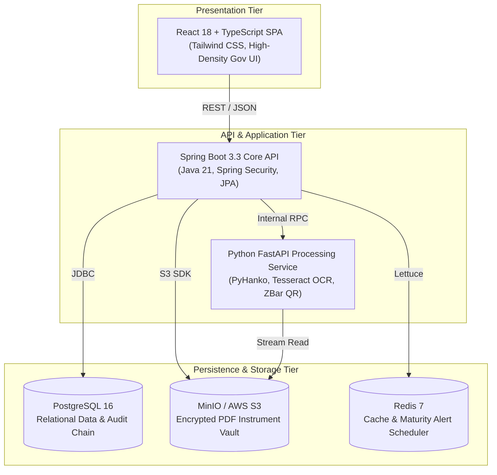

# Secure Stack — AICTE Security Deposit & FDR Management Portal

[](https://www.sih.gov.in/)
[](https://www.sih.gov.in/)
[](https://secure-stack-portal.vercel.app)
[](https://itstanishkraj007.github.io/Secure-Stack/)

> **Official Submission for Smart India Hackathon 2026**  
> **Problem Statement ID**: `26265`  
> **Ministry / Organization**: All India Council for Technical Education (AICTE), Ministry of Education, Government of India  
> **Project Name**: **Secure Stack**  
> **Title**: Streamline of security deposit / Fixed Deposit Receipt (FDR) portal  

---

## 🌐 Live Interactive Portal URLs

Test the complete system live in your browser:  
- 🚀 **Vercel Production**: **[https://secure-stack-portal.vercel.app](https://secure-stack-portal.vercel.app)**
- 🚀 **Alternate Mirror**: **[https://secure-stack-aicte.vercel.app](https://secure-stack-aicte.vercel.app)**
- 📚 **GitHub Pages Demo**: **[https://itstanishkraj007.github.io/Secure-Stack/](https://itstanishkraj007.github.io/Secure-Stack/)**

---

## 📌 Executive Summary & Problem Context

Under the **AICTE Approval Process Handbook (APH)**, technical institutions across India must submit and maintain substantial security deposits (Fixed Deposit Receipts or Bank Guarantees, often ₹15 Lakhs to ₹1 Crore+) pledged to the Member Secretary, AICTE. 

### The Real-World Challenges
1. **Manual Inefficiency & Physical Overhead**: Over 10,000+ technical institutions physically mail paper FDRs and renewal receipts to AICTE headquarters, leading to lost documents and reconciliation backlogs.
2. **Document Forgery & Tampering Risks**: Scanned PDFs submitted by bad actors may have altered maturity dates, manipulated principal amounts, or forged bank branch seals.
3. **Unmonitored Maturity & Silent Encashment**: Deposits frequently mature without timely renewal notifications, risking unauthorized liquidation without AICTE's explicit No Objection Certificate (NOC).
4. **Bureaucratic Clearance Bottlenecks**: Returning deposits upon institutional closure requires multi-department sign-offs (Scrutiny, PGRC, Vigilance, Finance, Legal) which previously took 6 to 18 months via paper files.

### The Secure Stack Solution
**Secure Stack** is an enterprise-grade, microservice-powered digital platform that transforms AICTE's security deposit management into an automated, transparent, and mathematically verifiable workflow.

---

## 🏗️ System Architecture



---

## 🛡️ Core Innovations & Capabilities

### 1. Three-Way Reconciliation Matrix (Scrutiny)
Every uploaded instrument is automatically cross-verified across three independent sources:
- **Submitted Data**: Form values entered by the institution nodal officer.
- **Computer Vision Extraction**: OCR extraction using Tesseract v5 with per-field bounding boxes and confidence scoring.
- **Cryptographic Ground Truth**: PyHanko PAdES-B-LT digital signature chain verification and QR payload decryption.
- Any mismatch (e.g., ₹25,00,000 submitted vs. ₹23,75,000 bank record) triggers an automatic hold with an SLA timer and one-click issuance of official **Form DEF-1 Clarification Demands**.

### 2. Sequential 5-Gate Clearance Hub
Release requests undergo strict, sequential institutional validation:
1. **Gate 1**: Regional Scrutiny Verification
2. **Gate 2**: Public Grievance Redressal Cell (PGRC) Clearance
3. **Gate 3**: Chief Vigilance Officer (CVO) Inquiry Check
4. **Gate 4**: Finance & Grants Cell (Outstanding recovery checks)
5. **Gate 5**: Legal Cell Final NOC (Unlocked only after Gates 1–4 are cleared)
*Once all gates clear, the system issues a cryptographically watermarked AICTE Sanction Order & Bank NOC.*

### 3. Cryptographically Linked Immutable Audit Ledger
- Every critical state transition (upload, OCR extraction, scrutiny decision, gate approval, NOC issuance) generates an immutable audit record.
- Each event calculates a SHA-256 hash incorporating the previous event's hash (`prevHash`), forming a continuous cryptographic chain.
- The interactive **Verify Chain** engine recalculates the entire ledger in real time to detect tampering, issuing an official **Certificate of Audit Integrity**.

### 4. Proactive Multi-Tier Maturity Monitor
- Automatic classification into countdown alert tiers: **T-90**, **T-60**, **T-30**, **T-15**, and **T-0**.
- Automated renewal lineage linking allows institutions to trace an FDR across consecutive renewal cycles (e.g., 2019 $\rightarrow$ 2021 $\rightarrow$ 2024 $\rightarrow$ 2026).

---

## 👥 Five Specialized User Roles

| Role | Workspace Route | Key Operational Responsibilities |
|---|---|---|
| **Institution Nodal Officer** | `/institution/dashboard` | Portfolio overview, 4-step intake wizard (`/institution/submit`), renewal linking, PDF dossier inspection |
| **Regional Scrutiny Officer** | `/scrutiny/queue` | Exception queue, 3-way discrepancy matrix, Form DEF-1 demands, SLA countdowns |
| **Internal Clearance Officer** | `/clearance` | Multi-gate clearance pipeline, resolving finance holds, issuing official Bank NOCs |
| **Regulation Bureau Head** | `/executive` | National dashboard (₹3,247.2 Cr portfolio), state-by-state heat map, high-priority interventions |
| **System Auditor & Admin** | `/audit` | Immutable audit trail, live SHA-256 chain re-verification, system-wide integrity proofs |

---

## 📂 Repository Directory Layout

```text
Secure-Stack/
├── frontend/                     # React 18 + TypeScript + Vite SPA
│   ├── src/
│   │   ├── components/           # GovHeader, Sidebar, Dossier Modals, StatusBadges
│   │   ├── context/              # PortalDataContext (State & SHA-256 Chain)
│   │   ├── data/fixtures/        # Realistic institution, scrutiny, and audit data
│   │   ├── pages/                # Dashboards for all 5 roles + Public Landing
│   │   └── utils/crypto.ts       # Web Crypto API SHA-256 Merkle chain generator
│   ├── Dockerfile                # Multi-stage production Nginx container
│   ├── nginx.conf                # SPA fallback configuration
│   └── package.json
│
├── backend/                      # Spring Boot 3.3.x Core API (Java 21)
│   ├── src/main/java/com/securestack/sdms/
│   │   ├── config/               # Security, OpenAPI, and Data Seeder
│   │   ├── controller/           # REST endpoints (Health, Instruments, Scrutiny, Clearance, Audit)
│   │   ├── entity/               # JPA Entities (Instrument, ScrutinyCase, ReleaseRequest, AuditEvent)
│   │   ├── repository/           # Spring Data Repositories
│   │   └── service/              # Transactional business logic & chain validation
│   ├── Dockerfile                # Eclipse Temurin 21 multi-stage container
│   └── pom.xml
│
├── processing-service/           # Python 3.11+ Document Forensic Microservice
│   ├── app/
│   │   ├── main.py               # FastAPI application & endpoints
│   │   ├── models/schemas.py     # Pydantic data models
│   │   └── services/             # PyHanko digital signatures, OCR, QR decoder
│   ├── Dockerfile                # Python Alpine container with Tesseract & ZBar
│   └── requirements.txt
│
├── docs/                         # Architecture blueprints & regulatory registers
├── infra/                        # Infrastructure scripts & cloud configs
├── docker-compose.yml            # Full multi-container orchestration
└── package.json                  # Root workspace proxy scripts
```

---

## 🚀 Getting Started Locally

### Option A: Running the Frontend (Zero Backend Dependency)
The frontend contains an interactive in-memory data engine with persistent `localStorage` and client-side SHA-256 chain generation:

```bash
# Clone the repository
git clone https://github.com/itstanishkraj007/Secure-Stack.git
cd Secure-Stack/frontend

# Install dependencies and start Vite dev server
npm install
npm run dev
```
Open **[http://localhost:5173/Secure-Stack/](http://localhost:5173/Secure-Stack/)** in your browser.

### Option B: Running the Full Stack via Docker Compose
To run the complete system (React Frontend + Spring Boot Core API + Python Processing Microservice + PostgreSQL + MinIO + Redis):

```bash
docker-compose up --build
```
- **React Frontend**: [http://localhost:5173](http://localhost:5173)
- **Spring Boot Core API**: [http://localhost:8080](http://localhost:8080)
- **Spring Boot OpenAPI Swagger**: [http://localhost:8080/swagger-ui/index.html](http://localhost:8080/swagger-ui/index.html)
- **FastAPI Processing Service**: [http://localhost:8000/docs](http://localhost:8000/docs)
- **MinIO Console**: [http://localhost:9001](http://localhost:9001)

---

## 📜 Regulatory & Legal Alignment
- **AICTE Approval Process Handbook (APH 2024-2027)**: Complete implementation of Chapter 1, Section 1.4 FDR stipulations and joint lien-marking rules.
- **Information Technology Act, 2000 (Section 65B)**: Admissible electronic evidence standards for PDF digital signatures and audit logs.
- **Reserve Bank of India (RBI) Master Directions on Fixed Deposits**: Adheres to guidelines on lien creation, joint holding, and interest crediting.

---

## 🤝 Smart India Hackathon 2026 Team: Secure Stack
Built with precision, deep regulatory research, and production-grade software craftsmanship for the All India Council for Technical Education.
